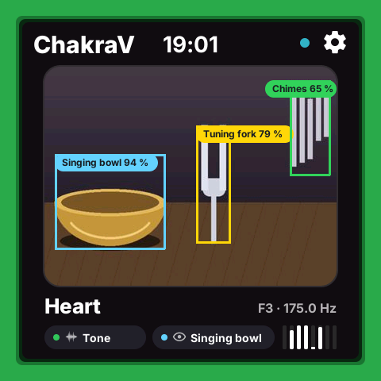
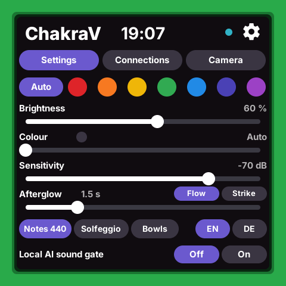
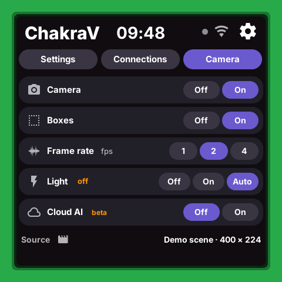
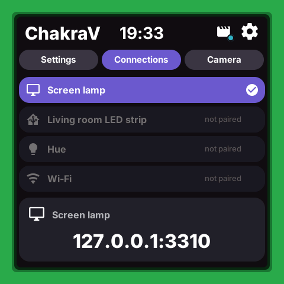

# ChakraV


**Chakra with video: hear the bowl, see the room, light it in the chakra's colour.**

ChakraV is the experimental sibling of **[ChakraA](https://github.com/leopardcodeai/chakraa)**, the audio app,
for Espressif's [ESP-Mosaico](https://mosaico.espressif.com) (ESP32-S31, 2.16" 480 x 480 touch screen,
microphone, camera slot). A thick frame around the screen glows in the colour of the chakra it hears, the
live picture sits in the middle, boxes mark the instruments, and two pills say what it hears and what it
sees. German: [README.de.md](README.de.md).

## Which one?

Two apps, one code base. In yoga and sound healing many people want no AI at all, or only AI that stays in
the room: **[ChakraA](https://github.com/leopardcodeai/chakraa) is built for that.** It works without any
AI, its one AI feature runs on the device, and it has no camera and no cloud. **ChakraV is explicitly the
experimental one**: it tries what a camera and bigger models can add.

| | [ChakraA](https://github.com/leopardcodeai/chakraa) (audio) | ChakraV (this one) |
|---|---|---|
| Listens | microphone | microphone and camera |
| AI | none needed; an optional local AI sound gate, on the device only | as much on the device as the ESP32-S31 runs, plus optional cloud models with your own API key |
| For | rooms where a camera is not wanted: the classic, private choice | experiments: what can it see and mark? |
| Maturity | evaluated against real recordings ([report](https://github.com/leopardcodeai/chakraa/blob/main/docs/evaluation/report.md)) | v0 |

If you do not need the camera, or want no AI beyond the device, take ChakraA.

| Live view | Settings | Camera | Connections |
|---|---|---|---|
|  |  |  |  |

All screenshots use the drawn demo scene (`tools/camera_live.py --demo`), never a real camera picture.

## What it does (v0, 26 October 2026)

| | Part | State |
|---|---|---|
| Hears | chakra detection, strikes by the spectral flux, lamps, screen lamp, local AI sound gate | as in ChakraA, the same C code |
| Lights | the frame and the lamps in the chakra's colour; calm light: 30 % brightness, a strike kicks at most once every 2 s, a gong swells and keeps the colour | simulator and host tests |
| Sees | live camera view 16:9, 400 x 224, from the Mac camera or a video, 1, 2 or 4 fps | simulator |
| Marks | instrument boxes with short pills ("Bowl", "Bowl C"), up to 7: on the Mac by OWLv2 (zero-shot) with a tracker that keeps the bowls and names a row by its notes | Mac only; on the board no detector yet |
| Shows | heard pill (orange dot) and seen pill (green dot), semitone spectrum with the chakra dots, indicator dot, Wi-Fi glyph | simulator |
| Camera light | Off, On, Auto (on while the picture is dark), the module's flash LEDs | simulator; board written, not run |
| Cloud AI | setting and request builder | **stub**: nothing is sent in v0 |
| Board camera | `main/camera.c`: opens the module, tells V1.4 from V1.2 by the sensor ID, makes the 16:9 view | **written, builds, not yet run** (board on order) |

**The light is the same in both apps.** Glow, kick, gong swell, fades, the screen lamp and every lamp
setting come from the same core code (`chakra_core.c`, `chakra_light.c`), and a change to them is made in
both. Flash safety comes from the rate: a kick counts as a flash however small (a red one under WCAG,
and a room lamp fills the field of view), so it comes at most once every 2 s, far under 3 a second;
compliance on real lamps is not measured. How well the hearing works is measured in ChakraA's evaluation: 83 % of strikes right in Flow and 87 %
in Strike over 70 strikes, 0.29 s and 0.03 s from strike to colour.


## The camera module

The ESP-Mosaico is expected with the **camera module V1.4 (SC101IOT)**, mounted **landscape**; the older
**V1.2 (OV3640)** works too. Both sit in the left slot. The app reads the sensor ID and names the module on
the Camera page ("SC101IOT v1.4 · 1280 × 720").

| | V1.4 (expected) | V1.2 |
|---|---|---|
| Sensor | SC101IOT, 1 MP, 2.9 µm pixels (better in a dim room) | OV3640, 3 MP, 1.75 µm pixels |
| Frame | 1280 x 720, 15 fps | 1024 x 768, 25 fps |
| Lens | 3.1 mm F1.8, manual focus, 73 x 42 degrees | 68 degrees diagonal |
| The app's 16:9 view, 400 x 224 | the whole frame at 5/16 | the centre 916 x 512 at 7/16, about 51 x 30 degrees |

Focus the V1.4 lens once, to the distance of the bowls, with the live view open.

<details>
<summary><b>Camera details: scaling, orientation, flash</b></summary>

- **Why 400 x 224.** The board's PPA scales in 1/16 steps; 1280 x 5/16 = 400 is the widest step inside the
  424 px panel. 224 rows instead of 225 keep the JPEG encoder on whole 16 x 16 blocks.
- **Sideways mount.** With `CHAKRA_CAM_LANDSCAPE 0` (`--mount portrait` in the emulation) the view is a 16:9
  band across the upright picture, 712 x 400 at 9/16, about 42 x 26 degrees on V1.4.
- **Orientation.** The sensor reads out unmirrored. Landscape: no turn, no mirror. Two build switches in
  `main/camera.c`, `CHAKRA_CAM_TURN_180` and `CHAKRA_CAM_MIRROR`, plus a text sheet and arrow test for the
  first run on the board.
- **Module ID.** PID 0xDA4A is the SC101IOT, 0x364C or 0x3641 the OV3640; the frame size only if that read
  fails. The slot EEPROM is logged but cannot tell the two apart. BSP: esp-mosaico-bsp 7cbfb39 (22.10.2026,
  with the camera PWDN fix for the SC101IOT).
- **Flash.** Two LEDs on GPIO34, LOW = on, open drain. How long they may stay on (heat) and Auto's dark
  threshold are still to be measured on the board.
- Background: [docs/CAMERA_BOARD_QUESTIONS.md](docs/CAMERA_BOARD_QUESTIONS.md).

</details>

## AI: on the device first, the cloud to compare

1. **On the device**, through ESP-DL: the local AI sound gate (EfficientAT mn05, the one ChakraA uses) and an
   instrument detector, ESPDet-Pico at 320 x 320, about 170 ms a detection estimated
   ([docs/DETECTOR_CHOICE.md](docs/DETECTOR_CHOICE.md)). Estimates so far: nothing is measured on hardware.
2. **In the cloud, optional**, with your own API key, to compare with the device. Off by default (Camera
   page, Cloud AI); it would send a picture of the room to the provider. Keys only from the device's secure
   storage or, on the Mac, the keychain through the environment; never from a file in this repository.

**Audio decides, vision only confirms.** A colour changes only on a steady pitch. The camera may hold a
change when it saw a gong or drum played, rescue a bowl the AI gate missed, or break a tie between two
ringing bowls; it never sets a colour or times a strike on its own (1 to 4 fps is too slow for a strike).
Why: [docs/SOUND_LIGHT_EXPERIENCE.md](docs/SOUND_LIGHT_EXPERIENCE.md), section 5. Not joined in v0 yet.

## Run it in the simulator

You need macOS, Python 3, ffmpeg and Pillow, and the Mosaico workspace next to this folder
(`../../workspace`).

```sh
./sim.sh --demo     # browser preview (the address it prints): demo bowls, the drawn scene with its boxes
./sim.sh --live     # the Mac's microphone with the local AI sound gate, and the Mac's camera
./sim.sh            # the app alone; feed it yourself:
python3 tools/chakra_feed.py tone 174.6             # one tone (Heart)
python3 tools/camera_live.py --demo --demo-boxes    # the demo scene
python3 tools/camera_live.py --video FILE --detect  # a video as the V1.4 module would see it, boxes by OWLv2
python3 tools/screens.py /tmp/chakrav-shots         # the four screenshots above (demo sources only)
```

**In the launcher.** Our Vibe Mode launcher simulation (`tools/mosaico_launcher.py` in the Mosaico
workspace, not part of this repository) has a ChakraV tile: Live (microphone, AI gate, Mac camera) or Demo.
With `--chakrav-video FILE` ChakraV plays a video instead: its picture in the view through its best 16:9
window, its sound to the detection, and a **Sound** button plays that sound on the Mac (on at the start).

**Camera and privacy.** macOS asks once for the camera permission; if it is refused, the script waits and
never works around it. Frames exist only in one temp file, overwritten by each next frame and deleted at
the end. With the camera Off, ffmpeg stops and the Mac's camera is off too.

<details>
<summary><b>Ports, the emulated module and the line protocol</b></summary>

Audio on 8710 (`CHAKRA_FEED_PORT`), lines on 8711 (`CHAKRA_AI_PORT`), so ChakraV and ChakraA never share a
port. The preview takes 3222 or the next free port.

`camera_live.py --module v1.4` (default) or `v1.2` turns a video into the module's picture, takes the
view's 16:9 band for the app, and gives the detector the whole frame at 3/4 size (960 x 540), where it
scores bowls far better. The Camera page's source line says what is emulated
("Video · SC101IOT v1.4 emulated").

| Line (port 8711) | Meaning |
|---|---|
| `frame\t<path>\t<luma>` | a JPEG of exactly 400 x 224; its mean luma drives the light's Auto |
| `boxes\tclear` then `box\t<label>\t<x>\t<y>\t<w>\t<h>\t<conf>` | a frame's marks, normalised 0..1, at most 7 |
| `source\t<text>\t<camera\|video\|demo>` | the Camera page's source line and the indicator dot |
| `sound\t<bowl\|other\|none>\t<strike>` | the local AI sound gate; while none has spoken for 5 s the detection leads alone |
| `camera\t<on>\t<boxes>\t<fps>\t<cloud>` | back to every client: the Camera settings |
| `camlight\t<on>\t<dark>` | back to every client: the camera light should be on or off |

</details>

<details>
<summary><b>Design</b></summary>

Per our Mosaico design rules (DESIGN.md in the workspace): top bar with title, clock, the camera and
microphone dot and gear; Inter; pills h/2; little text; English first, German in the settings. The frame is
28 px; two dark veils make it fade softly inward, because ESP-GSP has no blur. The 400 x 224 view sits under
the top bar, its edges the rows' edges below it: the name with note and Hz, then the heard and seen pills
and the spectrum.

References (25.10.2026): [Philips Ambilight](https://www.philips.ca/c-p/42PDL7906T_12) (the light extends
the picture onto the wall; here the frame extends the sound into the room),
[Apple Intelligence edge glow](https://vp0.com/blogs/apple-intelligence-glow-border-effect-code-ios-free-ios-template-vibe-coding-gui)
(an edge glow is a state, not decoration),
[Material Design, object detection in a live camera](https://m2.material.io/design/machine-learning/object-detection-live-camera.html)
(a continuous rectangle and a short label),
[Google Nest Hub ambient mode](https://www.techadvisor.com/article/732792/how-to-change-ambient-mode-on-google-nest-hub.html),
[Framer Border Glow Pro](https://www.framer.com/marketplace/components/border-glow-pro/).

</details>

## Next

1. **An own detector.** On the Mac, OWLv2 with the tracker marks bowls well on bright, clear pictures: seven
   of seven in five of six freely available chakra-set videos, and after one calibration round it names
   seven bowls by their notes. In a dim session with a wide lens it found two or three of many bowls.
   `tools/make_detector_data.py` lets OWLv2 propose boxes on video frames, a person checks them, and a small
   ESPDet-Pico for the ESP32-S31 is trained on them. That training pipeline (AGPL-3.0) lives apart in
   `../chakrav_detector`, local only.
2. **On the board**: run `main/camera.c` on the real module (orientation, module ID, colours, flash heat,
   Auto's threshold), then the trained detector on the ESP32-S31.
3. Measure the on-device AI on the board: the audio gate and the detector, latency and memory.
4. The real cloud call behind Cloud AI, to compare its boxes with the on-device ones.
5. Join what is heard and what is seen, by the fusion rule above.

## How it is built

| Part | File |
|---|---|
| Detection: FFT, harmonics, steadiness, strikes (spectral flux), mappings | `components/app_chakra/chakra_detect.c` |
| Screen: frame, camera view, boxes, pills, settings | `components/app_chakra/chakra_core.c`, `ui/make_scene.py` |
| Light: kick, gong swell, the gate's colour rule, lamp pace | `components/app_chakra/chakra_light.c`, `tests/test_light.c` |
| Board: microphone, Wi-Fi, lamps, settings (NVS key `chakrav`, version 6) | `main/main.c` |
| Board: the camera module, the 16:9 view, its luma, the flash | `main/camera.c` |
| Simulator side and feeders | `components/app_chakra/host/platform_pc.c`, `tools/chakra_feed.py`, `tools/camera_live.py` |
| Instruments on the Mac: OWLv2, the tracker, the best 16:9 window of a video | `tools/detect_owl.py`, `tools/bowl_tracker.py`, `tools/best_crop.py` |
| Training frames for an own detector (private, never committed) | `tools/make_detector_data.py` |
| Screenshots and checks | `tools/screens.py`, `tools/sim_shot.py`, `tools/check_frames.py` |

The internal names stay `app_chakra` and `gsp_chakra_*`, as in ChakraA.

## Licence

Apache-2.0. Made by [LeopardCode.AI](https://leopardcode.ai). A light and sound tool, not a medical device.
